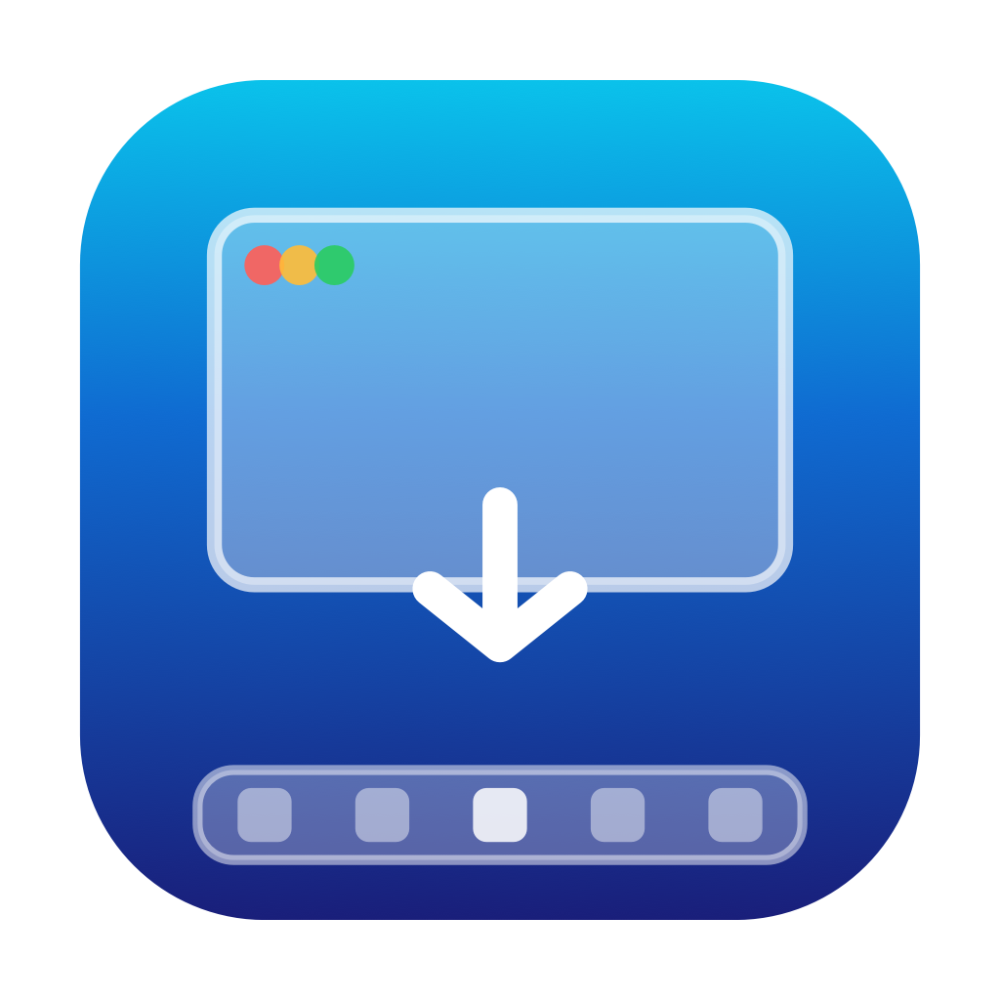
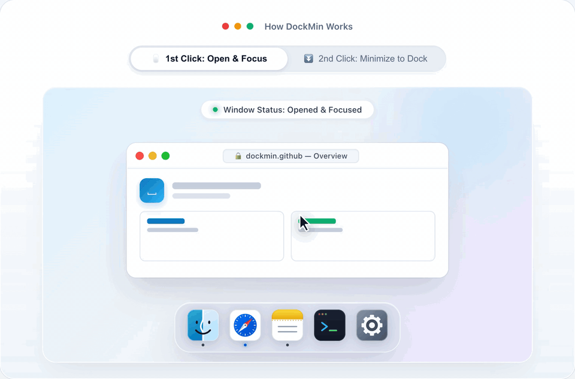

<div align="center">



# DockMin

**让 Mac Dock 拥有类似 Windows 任务栏的点击最小化交互。**

<p align="center">
  开源免费 · 适用于 macOS 14 及更高版本 · 体积仅约 1 MB
  <br><br>
  <a href="https://github.com/fatthreeking/DockMin/releases/latest">下载应用&nbsp;&rsaquo;</a>
  &nbsp;&nbsp;&nbsp;&nbsp;&nbsp;&nbsp;
  <a href="#3-从源码构建">从源码构建&nbsp;&rsaquo;</a>
  <br><br>
  <a href="README.md">English</a>&nbsp;·&nbsp;简体中文&nbsp;·&nbsp;<a href="README.ja.md">日本語</a>&nbsp;·&nbsp;<a href="README.ko.md">한국어</a>&nbsp;·&nbsp;<a href="README.es.md">Español</a>&nbsp;·&nbsp;<a href="README.de.md">Deutsch</a>
</p>

<br>



</div>

<br><br>

## 核心特性

<table width="100%">
  <tr>
    <td width="50%" valign="top">
      <br><br>
      <strong>点击切换。</strong><br>
      <small>点击打开，再次点击即刻最小化。</small>
    </td>
    <td width="50%" valign="top">
      <br><br>
      <strong>多屏原生支持。</strong><br>
      <small>外接显示器窗口位置精准保持。</small>
    </td>
  </tr>
  <tr>
    <td width="50%" valign="top">
      <br><br>
      <strong>极轻纯原生。</strong><br>
      <small>体积仅约 1 MB，零依赖包，空闲 CPU 占用几乎为 0%。</small>
    </td>
    <td width="50%" valign="top">
      <br><br>
      <strong>静默无感常驻。</strong><br>
      <small>无菜单栏或额外 Dock 图标，纯离线。</small>
    </td>
  </tr>
</table>

<br><br>

## 安装方式

### 1. DMG 拖拽安装（推荐）

下载 **[DockMin.dmg](https://github.com/fatthreeking/DockMin/releases/latest)** 并将应用拖入「应用程序」目录。  
首次启动在 **系统设置 → 隐私与安全性 → 辅助功能** 中勾选允许。

如遇系统安全拦截（提示「已损坏，打不开」或「无法验证开发者」），在终端中执行：

```sh
xattr -cr /Applications/DockMin.app
```

### 2. Homebrew

在终端中执行：

```sh
brew install --cask fatthreeking/tap/dockmin
```

### 3. 从源码构建

在终端中执行：

```sh
git clone https://github.com/fatthreeking/DockMin.git
cd DockMin
make install
```

### 彻底卸载

在「应用程序」中**再次双击打开 `DockMin.app`**，即可在弹出的管理窗口中选择 **「退出 DockMin」** 或 **「彻底卸载」**（一键清理开机自启项、重置辅助功能权限并将应用移至废纸篓）。

也可在终端中执行：

```sh
make uninstall
```

<br><br>

<div align="center">


<br>
<sub>代码遵循 MIT 开源协议。DockMin 名称与应用图标除外，衍生版本请使用自建标识。详见 <a href="LICENSE">LICENSE</a>。</sub>
<br>
<sub>由 <a href="https://x.com/fatthreeking">Fisher</a> 设计与开发。</sub>

</div>
